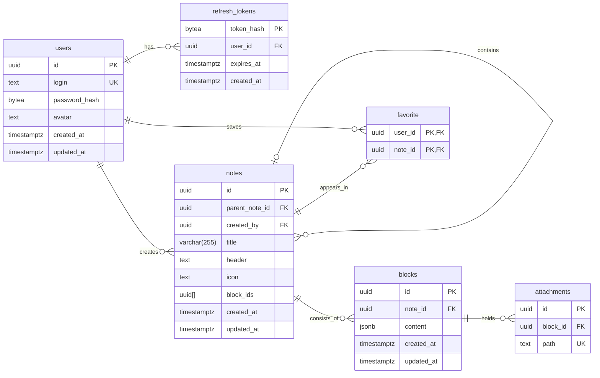

# 2026_2_BNN

Backend аналога Notion. Команда BNN.

Развёрнут: **https://brandnewnotes.ru**

## Структура

```text
build/             Dockerfile
cmd/main/          точка входа, роутинг
internal/models/   структуры данных
internal/pkg/      auth, notes, ctxutil, httpjson, middleware
migrations/        миграции БД
postman/           коллекция запросов
nginx.conf         конфиг nginx
Makefile           тесты, покрытие, генерация моков
```

## Запуск

Нужен Go 1.26.5 или новее.

```bash
git clone https://github.com/go-park-mail-ru/2026_2_BNN.git
cd 2026_2_BNN
cp .env.example .env
```

В `.env` заменить все `replace-me` на свои значения. Пароли можно сгенерировать: `openssl rand -hex 16`, для `JWT_SECRET` — `openssl rand -hex 32`.

Без них не запустится.

```bash
docker compose up -d --build postgres migrate s3 backend
```

Или база и S3 в Docker, а бэкенд локально:

```bash
docker compose up -d postgres migrate s3
go run ./cmd/main
```

Адрес: `http://localhost:5458`

## API

| Метод | Путь | Описание |
|---|---|---|
| POST | `/api/auth/signup` | Регистрация |
| POST | `/api/auth/signin` | Вход |
| POST | `/api/auth/refresh` | Обновить access и refresh токены |
| POST | `/api/auth/logout` | Выход |
| GET | `/api/auth/me` | Профиль текущего пользователя |
| GET | `/api/notes/getall` | Список своих заметок, параметры `limit` и `offset` |
| GET | `/api/notes/{id}` | Заметка с блоками по UUID |

Примеры запросов и ответов — в коллекции `postman/BNN.postman_collection.json`.

Ограничения: логин 3–20 символов и уникален, пароль 8–128 символов, тело запроса до 4096 байт. `limit` 1–100 (по умолчанию 10), `offset` от 0.


## Проверка

```bash
go build ./... && go vet ./... && go test -race -cover ./...
```

Тесты и покрытие через Makefile:

```bash
make test
make cover
```


## Схема БД

